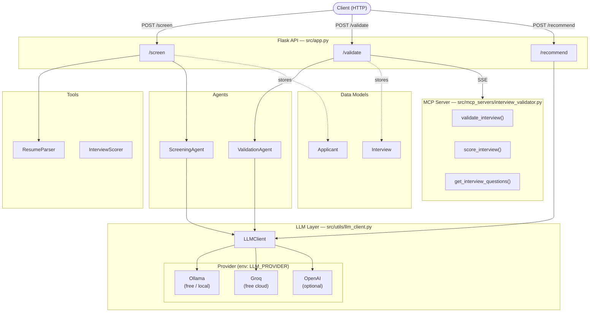

# Applicant Screening and Interview Validation System

An AI-powered applicant screening and interview validation system using open-source LLMs via Ollama, Groq, or OpenAI.

## Architecture



## Setup

### 1. Install dependencies

```bash
pip install -r requirements.txt
```

### 2. Choose an LLM provider

Copy `.env.example` to `.env` and set your provider:

```bash
cp .env.example .env
```

#### Option A: Ollama (free, local — recommended)

Install Ollama from [https://ollama.com](https://ollama.com), then pull a model:

```bash
ollama pull llama3.1
```

Set in `.env`:
```
LLM_PROVIDER=ollama
LLM_MODEL=llama3.1
OLLAMA_BASE_URL=http://localhost:11434
```

#### Option B: Groq (free cloud API)

Get a free API key at [https://console.groq.com](https://console.groq.com).

Set in `.env`:
```
LLM_PROVIDER=groq
LLM_MODEL=llama-3.1-8b-instant
GROQ_API_KEY=your_key_here
```

#### Option C: OpenAI

```
LLM_PROVIDER=openai
LLM_MODEL=gpt-4o-mini
OPENAI_API_KEY=your_key_here
```

### 3. Run the application

```bash
python src/app.py
```

The API will start at `http://localhost:5000`.

### 4. (Optional) Start the MCP interview validator server

```bash
python src/mcp_servers/interview_validator.py
```

## API Endpoints

| Method | Endpoint | Description |
|--------|----------|-------------|
| GET | `/` | System info and endpoint list |
| POST | `/screen` | Screen a candidate's resume |
| POST | `/validate` | Validate interview responses |
| POST | `/recommend/<id>` | Generate final hiring recommendation |
| GET | `/applicants` | List all applicants |
| GET | `/applicant/<id>` | Get a specific applicant's profile |

### Example: Screen a resume

```bash
curl -X POST http://localhost:5000/screen \
  -H "Content-Type: application/json" \
  -d '{
    "resume_text": "Jane Doe\njane@example.com\nSoftware Engineer with 5 years Python, AWS, Docker experience.",
    "job_requirements": {
      "required_skills": ["Python", "AWS"],
      "required_experience": "3+ years"
    }
  }'
```

### Example: Validate an interview

```bash
curl -X POST http://localhost:5000/validate \
  -H "Content-Type: application/json" \
  -d '{
    "applicant_id": 1,
    "interview_data": {
      "responses": {
        "Q1": "I have 5 years of Python experience building microservices.",
        "Q2": "I led a team of 4 engineers on a cloud migration project.",
        "Q3": "I use TDD and CI/CD to ensure code quality."
      }
    }
  }'
```

